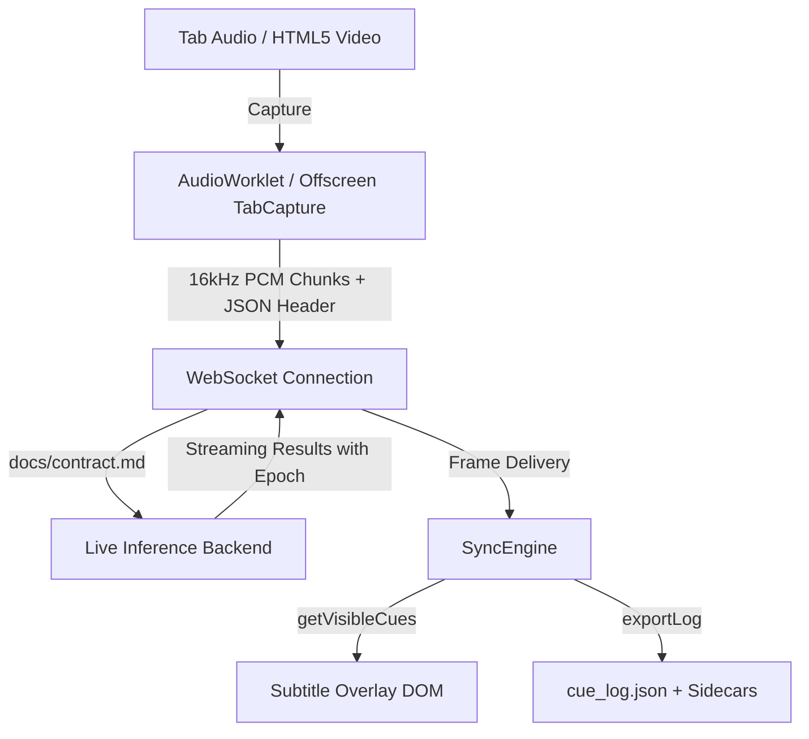

# System Architecture Draft

This document outlines the factual system architecture and data flow for the real-time subtitle translation extension. Unresolved or external implementation details are marked explicitly with `TODO(owner)`.

## 1. Capture Path
- **Mechanism**: Captures active tab audio using `chrome.tabCapture` or HTML5 media stream capture.
- **Audio Format**: 16,000 Hz, 16-bit linear PCM, mono channel.
- **Constraints**: Audio must only be captured when the tab is audible (`audible === true`) and video is playing.
- **Implementation Status**: `TODO(Role B)` — Finalize capture permissions, Offscreen document setup, and AudioWorklet processor.

## 2. Chunking & Network Framing
- **Framing**: Each chunk transmission consists of:
  1. UTF-8 JSON header frame (`chunk_id`, `epoch`, `client_timestamp`, `start_offset`, `end_offset`).
  2. Binary raw PCM data frame.
- **Chunk Duration**: Default 1000 ms (1.0 second) chunk intervals.
- **WebSocket Protocol**: Conforms to `docs/contract.md`.
- **Implementation Status**: `TODO(Role B, Role C)` — End-to-end WebSocket connection resilience and keep-alive handling.

## 3. Epoch & Lifecycle Management
- **Epoch Purpose**: Prevents stale in-flight results from popping up on screen after temporal jumps or context switches.
- **Epoch Invalidation Triggers**:
  1. **User Seek**: `engine.onSeek(newTime)` increments epoch; in-flight chunks bearing older epoch are dropped.
  2. **SPA Navigation**: `engine.onNavigation()` increments epoch and purges cue cache completely.
  3. **Video Advertisement**: `engine.onAdStart()` isolates ad speech; `engine.onAdEnd()` increments epoch before resuming main timeline.
- **Implementation Status**: Verified and active in `sync/syncEngine.js`. Extension event listeners: `TODO(Role B)`.

## 4. Sync Engine (`sync/syncEngine.js`)
- **Design**: Pure JavaScript ES module without DOM or browser extension API dependencies.
- **Time Conversion**: Converts chunk-relative offsets to video timeline:
  $$t_{\text{video}} = \text{video\_start\_time} + \text{offset} \times \text{playback\_rate}$$
- **Cache Persistence**: Cues cached keyed by `(epoch, chunk_id)` survive seek-back, enabling 0.0s instant recovery.
- **Overlap Replacement**: Newer epoch transcription replaces older overlapping cues from the same source.
- **Late-Cue Hold Policy**: If speech result arrives after speech end (`at >= end`), it is held visible for `minHold` (2.0s) from arrival time.
- **Render Loop Contract**: Subtitle overlay queries `getVisibleCues(video.currentTime)` every 50ms and calls `markShown(cue, video.currentTime)`.

## 5. Cue Log & Sidecars
- **Primary Log**: `cue_log.json` conforms strictly to `docs/cue_log.schema.json` (exact 8 fields: `start`, `end`, `lang`, `text`, `translation`, `source`, `first_shown_at`, `revisions`; `additionalProperties: false`).
- **Seek-Back Re-Show Entries (D1)**: Re-displayed cached cues emit an entry per shown epoch with the new `first_shown_at` to allow static evaluators to measure recovery.
- **Code-Mixed Language Sidecar (D2)**: `cue.lang` contains dominant single language string; full language list is exported to `<log>.langs.json` `{ [cue_index]: ["hi", "en"] }`.
- **Seek Events Sidecar**: Lifecycle events and stale-dropped metrics exported to `<log>.seeks.json`.

## 6. Privacy & Security
- **No Media Storage**: Neither raw audio nor video files are saved to disk. All streaming operates strictly in ephemeral memory.
- **Cloud Processing Notice**: Clear user disclosure in extension popup indicating audio is streamed for transcription.
- **Kill-Switch**: Dedicated user toggle in UI to immediately terminate WebSocket and halt audio capture.
- **Credential Hygiene**: Zero API keys or tokens committed in repository. Backend credentials managed via environment variables: `TODO(Role C)`.
